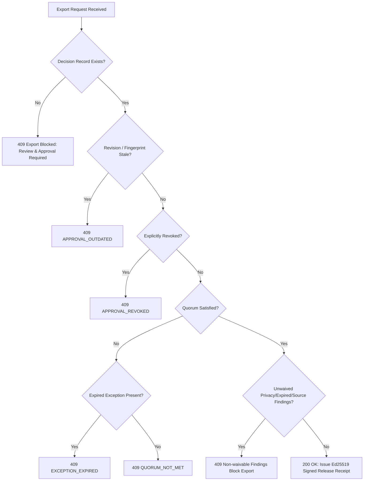

# Proofline 2.0 Architecture & Technical Specification

> **Autonomous Evidence Intelligence, AI Compliance, and Verifiable Approval Platform**

Proofline 2.0 is an enterprise content governance platform that replaces subjective AI confidence scores with **traceable evidence graphs, deterministic policy evaluation, multi-reviewer quorum approvals, automated re-review cascades, and Ed25519 cryptographic release passports**.

---

## 1. High-Level Architecture Diagram

```
┌─────────────────────────────────────────────────────────────────────────────┐
│                           Client / Presentation Layer                       │
│  Next.js 15.5 App Router · React 19 · Enterprise Dark Mode · Tailwind Tokens│
│                                                                             │
│  [Overview]  [Evidence Workspace]  [Document Reviews]  [Evidence Graph]     │
│  [Policy Studio]  [Approval Center]  [Verification Center]  [Risk Heatmap]  │
│  [Audit Explorer]  [Adversarial Lab]  [Integrations]  [Administration]      │
└──────────────────────────────────────┬──────────────────────────────────────┘
                                       │ HTTPS / JSON REST API
┌──────────────────────────────────────▼──────────────────────────────────────┐
│                    FastAPI Enterprise Backend Gateway                       │
│  - RBAC & Persona Context (Creator / Reviewer / Reviewer2 / Manager)        │
│  - Four-Eyes Separation of Duties & Multi-Reviewer Quorum Enforcement       │
│  - Session Management, CSRF & In-Process Rate Limiter                       │
│  - Server-Side Export Verification Gate (Strict Invariant I3)               │
└──────────────┬───────────────────────┬───────────────────────┬──────────────┘
               │                       │                       │
┌──────────────▼──────────┐ ┌──────────▼──────────┐ ┌──────────▼──────────────┐
│ Ingestion & SSRF Guard  │ │ Multi-Agent Engine  │ │ Deterministic Policy    │
│ - PDF, DOCX, TXT, CSV   │ │ Agent A: Extraction │ │ - Regex Engine          │
│ - Controlled Web Crawl  │ │ Agent B: Mapping    │ │ - Numerical Thresholds  │
│ - Private IP Quarantine │ │ Agent C: Retrieval  │ │ - Active Cert Validator │
│ - Content Fingerprinter │ │ Agent D: Verifier   │ │ - Terminology Checker   │
│   (Canonical SHA-256)   │ │ Agent E: Risk Model │ │ - NL Policy Synthesizer │
│                         │ │ Agent F: Redline    │ │                         │
│                         │ │ Agent G: Consistency│ │                         │
└──────────────┬──────────┘ └──────────┬──────────┘ └──────────┬──────────────┘
               │                       │                       │
┌──────────────▼───────────────────────▼───────────────────────▼──────────────┐
│                  Storage Layer & Optimistic CAS Gateway                     │
│                                                                             │
│  [Documents Gateway]                  [Workspace State Store]               │
│  - Per-document isolation             - Atomic CAS (BEGIN IMMEDIATE)        │
│  - SQLite WAL / Supabase Postgres     - Invariant I7 Mutation Protocol      │
│  - Proofline_cas_document RPC         - Pagination Guard (50/page)          │
└──────────────┬───────────────────────────────────────────────┬──────────────┘
               │                                               │
┌──────────────▼───────────────────────────────────────────────▼──────────────┐
│                       Cryptographic Security Core                           │
│                                                                             │
│  [Ed25519 Release Passport]           [SHA-256 Hash-Chained Audit Ledger]   │
│  - RFC 8032 Asymmetric Signatures      - Append-Only Event Preimages         │
│  - Server-Side Private Key Isolation   - Hash(n) = SHA256(Seq+Action+Prev)   │
│  - Public Verification Endpoint        - Bitwise Replay & Deletion Guard     │
│  - Sub-String Bitwise Tamper Simulator - Cryptographic Checkpoint Anchor     │
└─────────────────────────────────────────────────────────────────────────────┘
```

---

## 2. Seven-Stage Multi-Agent Claim Verification Pipeline

Proofline 2.0 avoids monolithic single-prompt LLM hallucinations by decomposing verification into 7 specialized, typed stages:

| Stage | Agent Name | Input | Responsibility | Failure/Quarantine Mode |
|---|---|---|---|---|
| **A** | **Claim Extraction Agent** | Raw Document Text | Segments text into atomic, testable claims (specs, SLA, certs, pricing, superlatives). | Fails if unparsable; returns raw strings without making approval decisions. |
| **B** | **Policy Mapping Agent** | Extracted Claims | Matches claims against active enabled governance rules (`RULE-001` .. `RULE-009`). | Flags unmatched claims as unclassified. |
| **C** | **Evidence Retrieval Agent** | Claim Keywords & Context | Hybrid retrieval over authorized source passages using BM25 and source trust weights. | Flags insufficient or outdated sources. |
| **D** | **Independent Verification Agent** | Claim + Exact Passages | Evaluates semantic agreement. Categorizes finding into: `SUPPORTED`, `CONTRADICTED`, `INSUFFICIENT_EVIDENCE`, `OUTDATED_SOURCE`, or `CONFLICTING_SOURCES`. | Inconclusive findings escalate to mandatory human review. |
| **E** | **Risk Assessment Agent** | Verification State + Rule Severity | Calculates non-linear business risk score ($0-100$) based on impact and likelihood matrix. | Never equates model confidence with regulatory safety. |
| **F** | **Report & Correction Agent** | Violations + Cited Passages | Synthesizes compliant redline suggestions strictly derived from active verified source passages. | Preserves original text; forbids silent rewriting. |
| **G** | **Final Consistency Validator** | Complete Review Run | Validates schemas, citation bounds, expiration dates, and prompt injection traps. | Rejects malformed JSON and enforces human review signoff. |

---

## 3. Flagship Round 3 Architectural Subsystems

### 3.1 Q1: Cascade Re-Review with Ownership & Per-Document Storage

#### A. Downstream Dependency Cascade
When an approved source, rule or fact changes, expires or conflicts:
1. **Dependency Analysis**: `affected_documents(state, *, sourceId, ruleId, factId)` crawls documents using exact applicability logic.
2. **Idempotent Task Generation**: `cascade_tasks` computes `dedupeKey = sha256(documentId + ':' + reason + ':' + triggerId)`. Only one open task per trigger exists.
3. **Atomic State Mutation**: Tasks and triggering events are committed inside the exact same `store(s).mutate(wid, fn)` closure (Invariant I7).
4. **Lifecycle Closure**: On successful re-approval of the new revision, `close_tasks_for_document` transitions all open tasks for that document to `status: "closed"` and `closedByReapproval: True`. Manual closure requires manager/assignee authorization and `reason ≥ 8 characters`.
5. **In-App Notifications**: Events generate in-app notification records (`state["notifications"]`) queried via `GET /api/notifications` (strictly in-app; no third-party email/Slack claims).

#### B. Per-Document Storage Gateway (`Documents`)
For library scale (up to 5,000+ documents):
- **Gateway Interface**:
  ```python
  class Documents:
      def list_ids(self, wid) -> list[str]: ...
      def read(self, wid, did) -> tuple[dict, int]: ...
      def read_many(self, wid, ids) -> dict[str, dict]: ...
      def write(self, wid, did, doc, expected=None) -> None: ...
      def delete(self, wid, did) -> None: ...
      def migrate_from_state(self, wid, state) -> int: ...
  ```
- **SQLite Engine**: Stores documents in dedicated `documents` table with `(workspace_id, doc_id)` primary key and `idx_documents_workspace` index.
- **Supabase Engine**: Uses `proofline_documents` table with Row Level Security enabled and server-side RPC `proofline_cas_document` running under `SECURITY DEFINER` with public grants revoked (Invariant I6).
- **Pagination Guard**: `GET /api/state?documents=page|none|all` enforces `PAGE_SIZE = 50` with cursor-based streaming, preventing payload blowups.

---

### 3.2 Q2: Benchmarked Detection Quality Enforced in CI

```
┌───────────────────────────┐      SHA-256 Check       ┌────────────────────────┐
│ benchmark/dataset.v1.jsonl│ ───────────────────────► │benchmark/manifest.json │
│ (Exactly 30 human items)  │                          │(Hash + Kappa: 0.88)    │
└─────────────┬─────────────┘                          └────────────────────────┘
              │
              ▼
┌───────────────────────────────────────────────────────────────────────────────┐
│                           scripts/eval_quality.py                             │
│  Modes: --offline (Deterministic fixtures) | --live (Pinned Gemini 2.5 Flash) │
│                                                                               │
│  Layer 1: Deterministic Rules Engine (Regex, Numbers, Scopes, Bounds)        │
│  Layer 2: AI Claim Verification (Overlap span validation, Substring bounds)   │
└─────────────┬─────────────────────────────────────────────────────────────────┘
              │
              ▼
┌───────────────────────────────────────────────────────────────────────────────┐
│                        Quality Gates (benchmark/gates.json)                   │
│  • rules.precision ≥ 0.95        • ai.precision ≥ 0.80                        │
│  • rules.recall    ≥ 0.90        • ai.recall    ≥ 0.75                        │
│  • rules.quoteValidity = 1.0     • ai.fpr       ≤ 0.15                        │
│  • ai.quoteValidity    = 1.0     • ai.failureRate ≤ 0.05                      │
│  • regression gate: max allowable metric drop ≤ 0.02                          │
└─────────────┬─────────────────────────────────────────────────────────────────┘
              │ Passes all 12 gates
              ▼
┌───────────────────────────────────────────────────────────────────────────────┐
│                  GitHub Actions Workflow (.github/workflows/quality.yml)      │
│  Enforces offline test integrity, dataset hash validation, and regression gates│
└───────────────────────────────────────────────────────────────────────────────┘
```

---

### 3.3 Q3: Multi-Reviewer Approval Policy & Server-Side Export Gate

#### A. Policy Configuration & Precedence
```json
{
  "byChannel": {
    "website": {"required": 2, "roles": ["reviewer", "manager"], "distinctUsers": true},
    "press_release": {"required": 2, "roles": ["reviewer", "manager"], "distinctUsers": true},
    "email": {"required": 1, "roles": ["reviewer", "manager"], "distinctUsers": true},
    "default": {"required": 1, "roles": ["reviewer", "manager"], "distinctUsers": true}
  },
  "bySeverity": {
    "high": {"required": 2, "roles": ["reviewer", "manager"], "distinctUsers": true}
  },
  "escalation": {"hours": 24, "to": "manager"}
}
```
- **Severity Precedence**: If a document has high-severity findings, `bySeverity["high"]` overrides channel defaults.
- **Exception Relief**: Active manager exceptions deduct required signatures down to minimum 1.

#### B. Strict Server-Side Export Gate Hierarchy (`GET /api/documents/{did}/export`)
Every export request is evaluated server-side. The frontend is never the gate (Invariant I3):


---

## 4. Cryptographic Security Core

### 4.1 Ed25519 Digital Release Passport
1. **Canonical Digest**: Document text is canonicalized and hashed via SHA-256:
   $$\text{Digest} = \text{SHA-256}(\text{Canonical}(T))$$
2. **Metadata Binding**: The payload binds `artifactId`, `revision`, `artifactHash`, `policyVersion`, `sourceVersion`, `signatures` (all distinct signers), and `timestamp`.
3. **Ed25519 Signing**: The server key ring signs the binary payload using RFC 8032 Ed25519.
4. **Tamper Detection**: Altering even one character modifies the digest, causing instant failure on passport verification.

### 4.2 Append-Only Hash-Chained Audit Ledger
Every action appends a block to the immutable event log:
$$\text{Hash}_n = \text{SHA-256}(\text{Seq}_n \parallel \text{Timestamp}_n \parallel \text{Action}_n \parallel \text{Actor}_n \parallel \text{Hash}_{n-1})$$
Any retroactive modification breaks the hash chain and is immediately flagged by the Audit Explorer.
