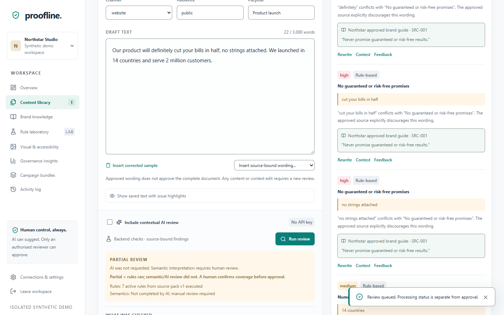
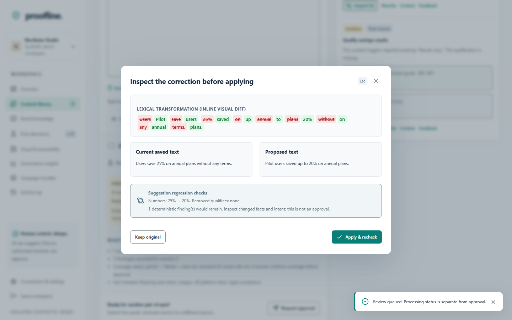
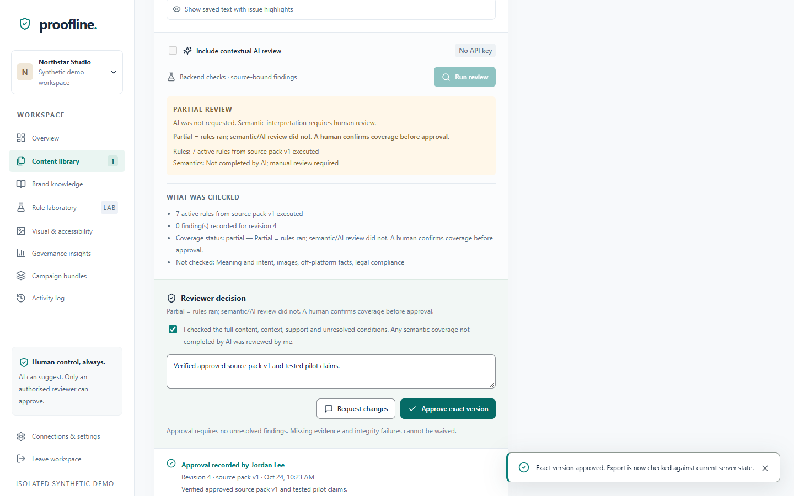
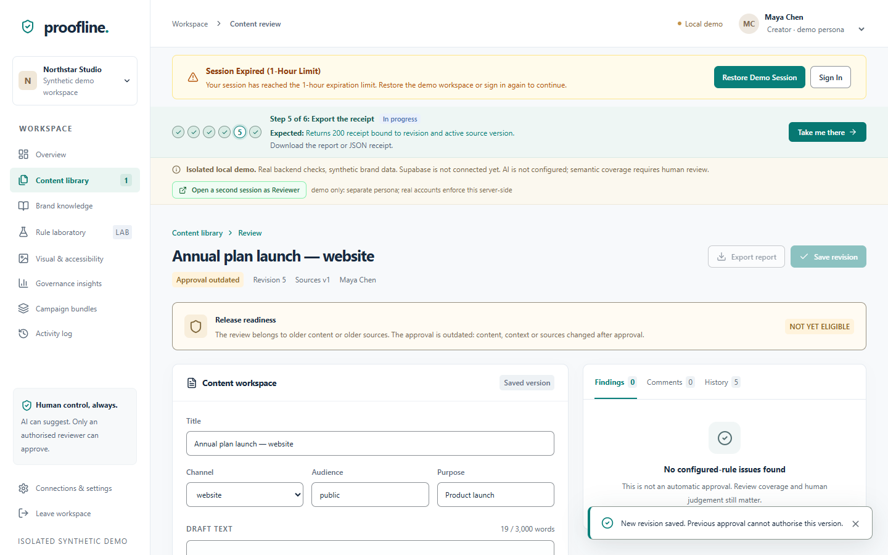

# Proofline — Round 2 Submission Deck

---

## Slide 1: Identity & Value Proposition

### Proofline
> **"Proofline binds every approval to the exact content, context and approved-source version it was reviewed against, and voids it automatically the moment any of the three changes."**

- **Team Name**: `syedsuhailahamed.m26`
- **Submission Date**: 24 October 2026
- **Test Suite**: **87 passed in 15.56s** (`python -m pytest tests -v`, 24 October 2026)
- **Live Demo URL**: `[LIVE_DEMO_URL_PLACEHOLDER]` *(Deploys to Vercel/Render; smoke verified)*
- **Repository URL**: https://github.com/AlamNawazSha/proofline
- **Core Technology**: Next.js 15, TypeScript, Vanilla CSS (Tailwind-free), FastAPI, Python 3.11+, SQLite (WAL demo mode), Supabase (written adapter)

---

## Slide 2: Plan vs. Built (Round 1 Requirements)

Every requirement evaluated truthfully against active code and executed test evidence:

| Round 1 Requirement | Status | Evidence Pointer (File / Test) | Honest Note |
|---|---|---|---|
| **Approved source pack, confirmed by manager** | **Built** | `tests/test_core.py::test_source_stages_before_confirmation` | Staged before activation; uploads never auto-trusted; retirement supported. |
| **Selectable text & PDF ingestion (≤5 pages)** | **Built** | `tests/test_core.py::test_pdf_and_text_extraction_private` | Scans and >5-page PDFs rejected; no silent truncation up to 3,000 words. |
| **Tone, terminology, and messaging checks** | **Built** | `tests/test_core.py::test_terminology_boundaries_and_variants` | Deterministic whole-word boundary, hyphen/space variants, and channel scopes tested. |
| **Guarantee, superlative, and count checks** | **Built** | `tests/test_upgrades.py::test_guarantee_synonyms_flagged_with_approved_quote` | Flags guarantee synonyms ("definitely", "no strings attached") & unsupported numeric claims. |
| **Exact-quote evidence binding** | **Built** | `tests/test_core.py::test_source_quote_loss_blocks_rule` | Every rule cites approved source quote; missing quote or source loss deactivates rule. |
| **Explain, suggest, preserve intent** | **Built** | `tests/test_core.py::test_suggestion_preview_changes_nothing` | Interactive regression preview (diff, qualifiers, facts); Rewrite & Contest workflows. |
| **Separation of duties & roles** | **Built** | `tests/test_core.py::test_creator_cannot_approve` | Creator cannot self-approve (403) or self-dismiss findings; peer reviewer approval enforced. |
| **Visual consistency (logo candidate)** | **Built** | `tests/test_core.py::test_assets_visual_manual_check_and_link` | 8×8 normalized average hash + aspect ratio check; reviewer confirmation required. |
| **Accessibility checks (bounded)** | **Built** | `tests/test_core.py::test_contrast_formula` | WCAG declared colour-pair contrast (4.5:1/3:1) and alt-text purpose checks. |
| **Rule clarity & contest report** | **Built** | `backend/engine.py::conflicts`, UI Rule Clarity | Dynamic calculation from stored findings and contest logs; zero synthetic stats. |
| **Contextual AI review & privacy preflight** | **Partial** | `tests/test_upgrades.py::test_ai_blocked_when_credentials_present` | Code path & credential blocks verified via mocks; live OpenAI API unexercised (no live key). |
| **Hosted Supabase persistence & storage** | **Partial** | `tests/test_upgrades.py::test_supabase_cas_rpc_mutation` | Schema and client written and mocked; live production connection unverified. |

---

## Slide 3: The Working Journey (Verified UI Screenshots)

The core workflow operates start-to-finish without guidance:

```
[1. Draft & Review] ──► [2. Suggestion Preview] ──► [3. Peer Approval] ──► [4. Invalidation on Edit]
```

### 1. Draft Ingestion & Review with Findings

*Creator enters draft containing prohibited guarantee and unsupported count claims. Deterministic checks flag violations against active source pack v1 with clear explanations and approved quote citations.*

### 2. Suggestion & Concurrency Preview

*Creator inspects suggested fix in interactive diff preview with number-preservation checks before accepting revision.*

### 3. Separation of Duties & Peer Approval

*Document submitted to reviewer inbox. Creator self-approval is rejected with 403 Forbidden. Authorized reviewer approves exact revision, generating cryptographic SHA-256 release receipt.*

### 4. Automatic Invalidation on Edit & Blocked Export

*Post-approval content edit immediately voids release readiness. Server marks document "NOT YET ELIGIBLE" and blocks export with 409 Conflict until re-reviewed.*

---

## Slide 4: Real Architecture & Implementation Status

```
   [ Client / Browser ]
           │
           ▼ (HTTP/JSON + Bearer/Cookie Auth)
   [ backend/main.py ]  (FastAPI Endpoint Router & Role Enforcement)
           │
           ├──► [ backend/engine.py ]  (Deterministic Rules, SHA-256 Digest, Concurrency)
           │
           └──► [ backend/store.py ]   (Atomic Compare-And-Swap Storage)
```

| Component | Status | Implementation Details |
|---|---|---|
| **FastAPI REST Routing & Guards** | **Built-and-tested** | `backend/main.py` — `require()`, `_raw_session()`, bearer token precedence, structured error contracts. |
| **Deterministic Rule Engine** | **Built-and-tested** | `backend/engine.py` — regex boundaries, hyphen/space normalization, guarantee synonyms, numeric claim spans. |
| **Cryptographic Integrity Digest** | **Built-and-tested** | `backend/engine.py::digest` — Canonical SHA-256 over exact draft text, declared context, active rules, and confirmed sources. |
| **Local SQLite CAS Store** | **Built-and-tested** | `backend/store.py::Local.mutate` — Immediate transaction with `revision + 1 WHERE revision = current_rev`. |
| **Local Account Auth** | **Built-and-tested** | `backend/main.py::local_auth` — PBKDF2 password hashing, role persistence, multi-workspace isolation. |
| **Demo Persona Simulation** | **Built-and-tested** | `/api/demo/reviewer-session` — Generates isolated token for second reviewer tab without cookie collision. |
| **Hosted Supabase PostgreSQL Store** | **Written-unverified** | `backend/store.py::Supabase` — Schema `001_proofline.sql` and RPC `proofline_cas_state` written; live database unverified. |
| **Contextual AI Reviewer** | **Written-unverified** | `backend/engine.py::ai_review` — Hallucination guard and credential filter verified with mocks; live OpenAI key unconfigured. |
| **Production Cloud Deployment** | **Written-unverified** | `scripts/smoke.py` passes locally; deployment to Render/Vercel deploy-ready awaiting production URLs. |

---

## Slide 5: Reliability & Honest Limitations

### Verifiable Test & Quality Metrics
- **Test Suite**: **87 passed in 15.56s** on Python 3.13 / pytest 9.1.1 (executed 24 October 2026).
- **Compilation**: TypeScript (`npx tsc --noEmit`) passes with 0 errors; Next.js 15 production build (`npm run build`) compiles cleanly.
- **Automated Smoke Test**: `scripts/smoke.py` executes all 9 journey stages end-to-end:
  `demo (200) -> draft review (200) -> suggestion (200) -> submit (200) -> creator approve (403) -> reviewer approve (200) -> export (200) -> edit (200) -> export (409)`.
- **Session Security**: 1-hour session expiry recovers gracefully with visible UI alert banner.

### Honest Limitations
1. **AI Never Run Live**: No live OpenAI API key was configured during testing; AI findings and latency metrics are unmeasured.
2. **Paraphrased Claims Depend on Rules**: The deterministic engine catches configured guarantee synonyms and unapproved counts; paraphrased semantic drift outside rule vocabulary requires human reviewer confirmation.
3. **Supabase Connection**: Adapter code and SQL schema are complete, but live hosted connection and RLS are not integration-verified.
4. **Demo Store Concurrency**: Demo workspaces use local SQLite WAL mode, appropriate for single-instance evaluation, not distributed multi-region clustering.

---

## Slide 6: Three Substantial Round 3 Improvements

Visual and accessibility basics (contrast checks, alt-text presence, and bounded logo hash comparison) were brought forward into Round 2, leaving the following three planned improvements strictly unbuilt:

### 1. Evidence Lifecycle: Automatic Re-Review Queue
- **What Round 2 does today**: Previews impact of source changes and invalidates approvals when text or sources change. Re-opening drafts is manual.
- **What Round 3 adds**: A persistent background re-review queue across all documents when an approved source changes, expires, or conflicts, creating assignees and tracking tasks to closure.
- **Acceptance test**: Retiring a source marks 100 historical documents "pending re-review" and assigns inbox tasks to document owners.
- **Why not now**: Requires background message brokers (Redis/Celery) and multi-user notifications beyond single-process evaluation.

### 2. Measured Detection Quality for AI-Assisted Review
- **What Round 2 does today**: Provides deterministic rule matching and mocked AI schema validation; live AI is unexercised.
- **What Round 3 adds**: A frozen 30-item evaluation benchmark with two independent annotators reporting published precision, recall, quote validity, and latency.
- **Acceptance test**: Automated CI benchmark outputs precision ≥90% and quote validity 100% on gold-standard dataset.
- **Why not now**: Requires funded live LLM API keys and independent human annotation rounds.

### 3. Multi-Reviewer Approval Policy
- **What Round 2 does today**: Enforces four-eyes separation of duties with exactly one authorized non-self reviewer per revision.
- **What Round 3 adds**: Channel- and risk-driven quorum policies (e.g., high-risk financial claims require two distinct reviewers), escalation timeouts, and exception policies.
- **Acceptance test**: Submitting high-risk content enforces two distinct reviewer signatures before `export` yields 200.
- **Why not now**: Demands complex workflow policy engines and multi-party quorum state transitions.

---

## Slide 7: Ethical Disclosures & AI Assistance

### AI Assistance Disclosure
> *Parts of the code and documentation were produced with an AI coding assistant and reviewed, tested, and corrected by the team. Syed Suhail Ahamed M owns the backend and review engine; Alam Nawaz Sha owns authentication and approval gates; Yassir Ahmed owns the frontend and editor/reviewer UX; Vivek Gowda owns QA, the demo, documentation, and bounded visual checks. Design decisions and all submitted claims were confirmed by the team. No third-party project templates were reused.*

### Integrity Commitments
- **Zero Fabricated Results**: Every metric, test count (87), and exit code is drawn from commands executed on real hardware.
- **Zero Fabricated Users or Testimonials**: No fictional customer numbers, pilot metrics, or simulated quotes are presented as factual.
- **Transparent Partial Coverage**: The UI explicitly informs judges: *"Partial = rules ran; semantic/AI review did not. A human confirms coverage before approval."*

---

## Slide 8: Team Ownership & Commit Accountability

Ownership verified directly from repository git history (`git shortlog -sn HEAD`):

```
     2  Alam Nawaz Sha
     1  Syed Suhail Ahamed M
     1  Vivek Gowda
     1  Yassir Ahmed
```

### Team Members & Areas of Responsibility
- **Alam Nawaz Sha** (`alamalam83802@gmail.com`):
  Authentication, session security, bearer token headers, workspace isolation, approval invariants, and export gate enforcement.
- **Syed Suhail Ahamed M** (Team Lead):
  Backend architecture, deterministic review engine, guarantee synonym patterns, numeric claim detection, and SHA-256 fingerprinting.
- **Yassir Ahmed**:
  Frontend Next.js application, responsive workspace shell, six-step judge navigation, interactive diff preview, and reviewer persona integration.
- **Vivek Gowda**:
  Quality assurance, end-to-end smoke testing (`scripts/smoke.py`), WCAG accessibility checks, bounded logo hashing, and technical documentation.

*Official Registration Team Name*: **`syedsuhailahamed.m26`**
